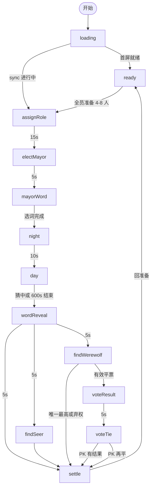

# 狼人真言 - 产品文档（kit 示例·精简）

> gameId: `werewords`  
> 版本: **v2.5-exit-flee**  
> **不含** IM/REST 字段（见 `im.md` / `rest.md`）

> **这是 kit 的示例文档**，取自实测游戏「狼人真言」并做精简：保留**章节结构、矩阵表列、交互词表、壳层与布局约定、Preview 附录**等通用写法；对局阶段只完整展开 3 个（`loading` / `ready` / `night`），其余阶段以「结构同上」占位。  
> 完整版真源：`werewords` 仓 `docs/games/werewords/product.md`。撰写新游戏时以 `product-doc.template.md` 为骨架，以本文件为**详略程度与写法**参照。

[[_TOC_]]

---

## 1. 概述

| 项 | 内容 |
|----|------|
| 游戏名称 | 狼人真言（Werewords） |
| 适用场景 | 语音房 H5 小游戏，4～8 人 |
| 角色 | 随机指定**村长** 1 名（额外身份）；所有玩家随机分配为**狼人** 1 名、**预言家** 1 名、**其余为平民** |
| 玩法概述 | 玩家们通过向村长提问猜出**魔法咒语**，过程中留意每个人的身份，决出狼人阵营与好人阵营的胜负 |

### 整局流程

> 各阶段**主流程**概览；分支、异常与元素细节见后文各阶段章节。`find-seer` 与 `find-werewolf`（及 `vote-tie`）互斥。  
> **视角列随阶段变化**：开局尚不知身份与村长；产生村长后仅知**谁是村长**；**分配身份**后各玩家仅知**自己**的身份，不知他人。

#### A. 开局（尚未分配身份，尚未产生村长）

| 阶段 | 已加入玩家 | 观众 |
|------|------------|------|
| **准备阶段** | 加入后可「准备 / 取消准备」；全员准备且 4～8 人时**自动开局**（后端） | 可「加入游戏」；加入后同左 |

#### B. 分配身份（各玩家仅知**自己**身份；尚未产生村长）

| 阶段 | 已加入玩家 | 观众 |
|------|------------|------|
| **随机身份** | 抽取并查看**自己的**身份牌 | 等待，无身份牌 |

#### C. 产生村长与选咒（已知村长是谁；身份已分配）

| 阶段 | 村长 | 其他已加入玩家 | 观众 |
|------|------|----------------|------|
| **随机村长** | 被公示为本局村长 | 观看公示 | 观看 |
| **村长选咒语** | 从候选中选择或自定义**魔法咒语** | 等待，**不可见**咒语候选 | 观看 |

#### D. 对局（下表按「若你是该身份」描述，**仅见自己身份**）

| 阶段 | 村长 | 预言家 | 狼人 | 平民 | 观众 |
|------|------|--------|------|------|------|
| **天黑** | 咒语常显（`night` 可切换掩码） | intro 后右上角显词，可 toggle | 同预言家 | 掩码 + 字数 | 掩码 + 字数（同平民） |
| **天亮** | 回答提问；**不可**提问或猜咒语 | 提问或猜咒语；可切换查看咒语 | 同预言家 | 提问或猜咒语；咒语为掩码 | 观战，只读 |
| **咒语公示** | 观看咒语揭晓 | 同左 | 同左 | 同左 | 观看 |
| **找预言家** | 等待 | 等待 | 指认一名玩家是否为预言家 | 等待 | 观看 |
| **找狼人** | 投票指认狼人 | 同左 | 同左 | 同左 | 观看 |
| **平票PK** | 若非平票当事人：在 PK 候选人中再投一票 | 同左 | 同左 | 同左 | 观看 |
| **结算** | 查看胜负、全员身份公示与统计 | 同左 | 同左 | 同左 | 查看结果；可回首页或加入 |

> **重叠说明**：同一人可同时是村长与某身份（如平民）。表中「村长 / 预言家 / 狼人 / 平民」列描述**你持有该身份时**的行为；兼任村长时，**天亮**等阶段优先按村长列。

### 前后端职责

| 侧 | 职责 |
|----|------|
| **后端** | 全部游戏逻辑真源：阶段流转、胜负、计票/平票/弃权、猜中判定、逃跑与换村长、倒计时、队列等 |
| **前端** | 按契约展示 UI、采集操作并上报；**不实现、不推断**裁决逻辑；只渲染 IM/sync 下发的状态 |

> ④ 对接时以后端契约为准。冲突记入 `CONTRACT_GAPS.md`，不得前端自行补逻辑。

---

## 2. 全局规则

### 2.1 阶段总表

| 阶段 ID | 显示名称 | 时长 | 前端倒计时 |
|---------|----------|------|------------|
| `loading` | 加载中 | - | 否 |
| `ready` | 准备阶段 | - | 否 |
| `assign-role` | 随机身份 | 15s | 是 |
| `elect-mayor` | 随机村长 | 5s | Preview 是* |
| `mayor-word` | 村长选词 | 15s | 是 |
| `night` | 天黑请闭眼 | 10s | 是 |
| `day` | 天亮了 | 600s | 是 |
| `word-reveal` | 词语公示 | 5s | Preview 是* |
| `find-seer` | 找预言家 | 30s | 是 |
| `find-werewolf` | 找狼人 | 60s | 是 |
| `vote-result` | 投票结果 | 5s | Preview 是* |
| `vote-tie` | 平票PK | 60s | 是 |
| `settle` | 结算 | - | 否 |

> `find-seer` 与 `find-werewolf`（+`vote-result`/`vote-tie`）互斥。猜中与白天超时均经 `word-reveal` 再分流。  
> **倒计时展示**：有「前端倒计时」的阶段，阶段提示条主文案后行内展示 `{N}s`（**统一秒数**）；由 `stage-ui-config.showCountdown` 与后端下发 `countdownSeconds` 控制。  
> \* **Preview**：`elect-mayor` / `word-reveal` / `vote-result` 在**流程内**倒计时结束后自动切阶段；**侧栏直切**时展示预设秒数、**不递减、不跳转**。

### 2.2 状态流转



**节点 ID**（与 H5 `currentStage` / §2.1 一致）：`loading` · `ready` · `assignRole` = `assign-role` · `electMayor` = `elect-mayor` · `mayorWord` = `mayor-word` · `night` · `day` · `wordReveal` = `word-reveal` · `findSeer` = `find-seer` · `findWerewolf` = `find-werewolf` · `voteResult` = `vote-result` · `voteTie` = `vote-tie` · `settle`

**分支说明**（互斥/例外路径；线性定时推进可省略）：

| 分支点 | 条件 | 下一阶段 |
|--------|------|----------|
| `loading` | 首屏 sync 完成 | `ready` |
| `loading` | 房间已在进行中 | 按 sync 真实阶段 |
| `ready` | 全员准备且 4～8 人 | `assign-role` |
| `word-reveal` | 猜中且狼人未逃 | `find-seer` |
| `word-reveal` | 猜中且狼人已逃 | `settle` |
| `word-reveal` | 白天超时未猜中 | `find-werewolf` |
| `find-werewolf` | 唯一最高票或第一轮全员弃权 | `settle` |
| `find-werewolf` | 有效平票且候选人 ≥ 2 | `vote-result`（5s 过渡）→ `vote-tie` |
| `vote-tie` | PK 后唯一最高 / 再平 | `settle` |
| `settle` | 本局结束 | `ready` |

### 2.3 角色

| 角色 | 说明 |
|------|------|
| 已加入玩家 | 入座参与本局；按身份与阶段操作 |
| 观众 | 未加入；观战；准备阶段可加入；结算可回首页/加入 |
| 村长 | 选词；天亮只回答不提交；参与找狼人投票；知晓词语 |
| 预言家 | 1 人；知晓词语；天亮可提问/猜词（兼村长则不可）；投票票权 1 |
| 狼人 | 1 人；知晓词语；未逃时找预言家阶段指认；投票票权 1 |
| 平民 | 不知词语；天亮可提问/猜词（兼村长则不可） |
| 逃跑玩家 | **仅主动退出**且处于局中时记逃跑（断线/关窗/切后台不算）；不可操作；仍可被投。细则见 §2.8 |

### 2.4 胜负与解散

| 结果 | 条件 | 胜利文案 | 失败文案 |
|------|------|----------|----------|
| 好人胜（找狼命中） | 指认对象是狼人 | 好人获胜！（副：大家齐心协力找到了狼人） | 狼人惜败~（副：同左） |
| 狼人胜（找狼未中） | 指认非狼人 | 狼人获胜！（副：大家没有找到狼人） | 好人惜败~（副：同左） |
| 狼人胜（第二轮再平） | 第二轮仍平票 | 狼人获胜！（副：PK阶段仍然平票，无人出局） | 好人惜败~（副：同左） |
| 解散 | 未逃跑玩家 ≤ 3 | 人数不足，本局提前结束。 | 同左，无胜负阵营 |

> 完整胜负矩阵（含找预言家分支、全员弃权、观众摘要）见 werewords 仓真源。

### 2.5 全局边界（细则见各阶段）

- 局中观众不可入座
- 未逃跑 ≤ 3 人 → 解散
- 前端不处理竞态，以后端先到的消息为准
- `http-config` 暂沿用仓库预设
- **退出 / 逃跑**：见 §2.8（断线不等于逃跑）

### 2.6 状态同步策略（④ 参考）

| 触发 | 需要 | 期望 |
|------|------|------|
| 进页 / 房间就绪 | 是 | 进入真实阶段 |
| App 回前台 | 是 | 静默 sync |
| 断网恢复 | 是 | 恢复阶段与局内状态（**不**因此记逃跑） |
| 倒计时结束无推送 | 是 | 短时后 sync 兜底 |
| 结算回 ready | 是 | sync 入座列表 |

### 2.8 退出与逃跑（退出确认）

> 各游戏按玩法裁剪；本示例对齐「仅主动退出记逃跑」口径。壳层弹层推荐 kit `web-alert`，Preview 挂到视口 `[data-toast-root]`。

| 场景 | 是否确认框 | 后端 | 前端 |
|------|------------|------|------|
| 观众 / loading / settle / 已逃跑 | 否（或仅关页） | 无 leave 或无副作用 | 关 WebView / 关页 |
| ready 已入座 | 是 | leave：离座，**不**记逃跑 | 确认后 leave + 关页 |
| 局中已入座 | 是 | leave：记**逃跑** | 确认后 leave + 关页 |
| 断线 / 关窗 / 切后台 | - | **不**记逃跑 | sync 恢复 |

### 2.7 GitLab Markdown 渲染约定

> 真源：`h5-game-kit/docs/LESSONS.md` **L-2026-07-15-01**。本示例 Mermaid 已按此编写。

| 场景 | 规则 |
|------|------|
| Mermaid 状态流转（§2.2） | 用 **`flowchart TB`**；节点 ID **camelCase**；边标签短句；分支条件放 **分支说明表** |
| Mermaid 边标签 | 不用 `～`、`≤`、`≥`、全角括号；用 ASCII 与短横线文案 |
| 表格空单元格 / 不可见 | 用 `-`，不用破折号 `—` |
| **文档内锚点链接** | GitLab 17+ 按 Comrak 算法：小写 → **删除**标点（含 `.`、`：`、`（）`）→ 空格变 `-` → 重复标题加 `-1`…。例：`### 3.0.2 阶段壳配置（显隐）` → `#302-阶段壳配置显隐` |

---

## 3. 组件规则
> 各阶段通过链接引用本节。元素 ID 统一 `el-*`，与 H5 `data-testid` 一致。

### 3.0 壳层与正文（渲染策略）
整局 H5 采用 **「固定壳 + 切换正文」**：外层壳只 mount 一次；阶段切换时**不**整页卸载再重建。

#### 3.0.1 固定壳（不随阶段卸载）

| 壳层区域 | 实现 | 阶段切换行为 | 需保留的 UI 状态 |
|----------|------|--------------|------------------|
| 顶栏 | `GameLayout` | 始终展示 | 音乐按钮开/关 |
| Logo 区 | `GameLayout` | 按 `showLogo` 显隐 | - |
| 阶段提示条 | `StageHintRouter` | 槽位固定；**文案**随阶段/视角变 | - |
| 玩家列表 | `PlayerList` | 按 `showPlayerList` 显隐；**显隐会卸载**（仅 `loading` 隐藏） | 提问气泡计时、投票选中等**随 store** |
| 全屏蒙层 | `StageOverlayRouter` | 槽位固定；内部 overlay 条件 mount | 见 [§3.0.4](#304-蒙层-remount) |

> **玩家列表**：`day → word-reveal` 切换时列表**不卸载**，故提问气泡可自然保留至 5s 到期。

#### 3.0.2 阶段壳配置（显隐）

真源：`src/lib/stage-ui-config.ts`（`STAGE_UI_CONFIG`）。

| 字段 | 含义 |
|------|------|
| `showLogo` | Logo 区（`ready` 为 true） |
| `showStageBanner` | 阶段提示条（`settle` 为 false） |
| `showCountdown` | 是否允许展示倒计时（仍需局内 `countdownSeconds != null`） |
| `showPlayerList` | 玩家列表（`loading` 为 false） |
| `layoutMode` | `loading` / `ready` / `default` / `fill` |
| `showAskBubbles` | 玩家列表提问气泡（`day`、`word-reveal`） |

#### 3.0.3 阶段正文（随阶段 remount）

正文由 `StageBodyRouter` 按阶段**互斥切换**：进入新阶段时卸载旧正文、挂载新正文，**不保留**组件内局部 state（滚动位置、未提交输入等），除非写入 **Pinia / 局状态**。

| 阶段 ID | 正文 SFC | 主要 UI |
|---------|----------|---------|
| `loading` | `StageLoading` | Logo + 加载动画 |
| `mayor-word` | `StageMayorWord` | 咒语候选 grid、自定义输入、确认 |
| `day` | `StageDay` | 天亮问答区 |
| `vote-result` / `settle` | `StageVoteResult` / `StageSettle` | 投票汇总 + 详情列表（`settle` 内嵌复用） |
| 其余 | （无正文 SFC） | 仅壳层 + 蒙层/提示条 |

> 需跨阶段保留的数据（咒语、问答队列、投票选中、气泡计时）放 **store**；**不要**为保留局部 state 把整段正文抬进固定壳。

#### 3.0.4 蒙层 remount
`StageOverlayRouter` 内各 overlay（随机村长、身份抽取、天黑 intro）在条件为真时**独立 mount**，关闭或切阶段后**卸载**。Preview 跳阶段再跳回会**重新播放** intro，不保留蒙层内步骤 state。

---

### 3.1 全局壳

| 项 | 约定 |
|----|------|
| **布局顺序**（非 loading） | **顶栏**（左上返回、右上音乐）→ **阶段提示条**（提示居中，倒计时在右）→ **玩家列表**（含右上角咒语位）→ **阶段正文**；**`ready` 另含 Logo 区**与**底栏** |
| **壳层实现** | `GameShellLayout` + `stage-ui-config` 控制显隐；详见 [§3.0](#30-壳层与正文渲染策略) |
| **`loading` 布局** | 顶栏 + 中部垂直居中块：**Logo**（紧贴转圈动画上方）→ 加载动画；**无**阶段提示条、玩家列表 |
| **阶段提示** | 独立 `stage-banner` 区域；文案**居中**；多数阶段全员同文案，部分阶段按视角区分 |

| 元素 ID | 文案 | 说明 |
|---------|------|------|
| `el-btn-back` | （返回箭头） | **全阶段**；顶栏左上角；**可点击** |
| `el-btn-music` | （音符） | **全阶段**；顶栏右上角；**可点击（切换）**；Preview 无真实音频 |
| `el-header-title` | 狼人真言 | Logo 中文主标题；**`loading` / `ready`** |
| `el-header-subtitle` | Werewords | Logo 英文副标题；**`loading` / `ready`** |
| `el-stage-title` | 当前阶段提示 | 阶段提示条；**loading 不展示** |
| `el-countdown` | {N}s | §2.1 前端倒计时=是 的阶段；紧接主文案后 |
| `el-toast-error` | （动态） | 校验/错误 toast |

**滚动条**：可滚动区域使用 kit 通用 class **`kit-scrollbar`**（真源 `public/css/kit-scrollbar.css`，见 kit `TECH-STACK.md` §5.5.1）。

### 3.2 玩家列表

| 项 | 约定 |
|----|------|
| **容器** | `el-player-list`；split 模式下带 `data-split-layout="true"` |
| **外观** | **无卡片底色**；头像**实线**边框 |
| **昵称行** | 头像下方一行：**座位号** → **昵称** → 状态徽章；超长昵称截断（`truncateNickname`） |
| **空位** | 仅 **`ready`**（grid）：固定 **8 格**，未满时展示空位格 |
| **滚动** | 列表项超出可视区时可滚动 |

#### 3.2.1 布局模式与切换时机
玩家列表有 **两种布局**，由阶段决定；**不在阶段内做布局过渡动画**。

| 布局模式 | 容器标识 | 视觉结构 | 适用阶段 |
|----------|----------|----------|----------|
| **grid（4 列矩阵）** | 无 `data-split-layout` | 全部玩家同等排列于 4 列网格；`ready` 固定 8 格含空位 | `ready`、`assign-role`、`elect-mayor` |
| **split（村长独立行）** | `data-split-layout="true"` | **村长**单独一行居中、头像放大；其余玩家在下方 4 列矩阵补位 | `mayor-word` 起至 `settle` |

| 切换规则 | 说明 |
|----------|------|
| 何时切 split | 进入 **`mayor-word`** 时立即采用；此前阶段保持 grid |
| 何时回 grid | 本局结束回 **`ready`** / **`loading`** 时重置 |
| 本局内 | split 产生后**保持至 `settle`** |

**各阶段速查**

| 阶段 | 是否展示 | 布局 | 备注 |
|------|----------|------|------|
| `loading` | 否 | - | - |
| `ready` | 是 | grid | 8 格含空位 |
| `assign-role` / `elect-mayor` | 是 | grid | 蒙层期间仍 grid；无村长星标 |
| `mayor-word` 起至 `settle` | 是 | split | 村长星标起展示 |

| 元素 ID | 文案 | 说明 |
|---------|------|------|
| `el-player-list` | - | 容器；布局见 [§3.2.1](#321-布局模式与切换时机) |
| `el-player-item` | - | 有玩家的格；投票/指认阶段为**可点击（选中）** |
| `el-player-slot-empty` | {座位号} | **仅 `ready`** |
| `el-mayor-badge` | （五角星） | `mayor-word` 起 |
| `el-word-display` | 咒语 / 掩码 | **`night` 起**；列表右上角；见 [§3.3](#33-词语展示区) |

### 3.3 词语展示区

| 元素 ID | 文案 | 说明 |
|---------|------|------|
| `el-word-display` | 咒语 / 掩码 | 知晓者见明文；不知晓者见 `？`×字数 |
| `el-word-length-hint` | {N}个字 | `night` 起常显 |
| `el-btn-word-toggle` | 👁 | 知晓者切换明文/掩码；村长仅 `night` |

---

> **阶段详情表（§4 起）**：**元素 ID** 为第一列；**文案** 为第二列；后续列为本阶段适用的**视角**；最后一列为**异常/备注**。  
> **通用组件也必须逐阶段列出**：即便 [§3](#3-组件规则) 已定义样式与交互，各阶段表格仍须写明该阶段是否展示（`el-player-list`、`el-stage-title`、`el-countdown` 等），不可只写阶段专属元素。玩家列表须注明本阶段的**布局模式**。  
> **单元格取值**：  
> - `-` 不可见  
> - `可见` 只读展示（可加括号说明，如 `可见（掩码）`）  
> - `可点击` / `可点击（单选）` / `可点击（切换）` / `可点击（选中）`  
> - `可输入` 文本框键盘输入  
> - `可滚动` 内容区可上下滑动  
> 同一元素多种交互时用最贴切的一项；前置条件、禁用态写在**异常/备注**。

## 4. 阶段：loading
### 4.1 说明

| 项 | 内容 |
|----|------|
| 目的 | 首屏 sync 完成前展示加载 |
| 时长 | - |
| 进入 | 打开游戏页 |
| 离开 | 首屏数据就绪 → 真实阶段 |
| **布局** | 顶栏 → 中部居中：**Logo**（转圈动画正上方）→ 加载动画；**无**阶段提示条、玩家列表 |

**组件**：[全局壳](#31-全局壳)（**子集**：本节 spinner）

### 4.2 视角·元素·异常

| 元素 ID | 文案 | 全员 | 异常/备注 |
|---------|------|------|-----------|
| `el-btn-back` | （返回） | 可点击 | 顶栏左上；全阶段 |
| `el-btn-music` | （音乐） | 可点击（切换） | 顶栏右上；默认旋转 |
| `el-header-title` | 狼人真言 | 可见 | Logo 中文；加载动画**上方** |
| `el-header-subtitle` | Werewords | 可见 | Logo 英文 |
| `el-stage-title` | - | - | 本阶段不展示 |
| `el-countdown` | - | - | 本阶段不展示 |
| `el-player-list` | - | - | 本阶段不展示 |
| `el-loading-spinner` | （加载动画） | 可见 | - |
| `el-toast-error` | 加载失败… | 可见 | 加载失败：toast，可重试（④） |

---

## 5. 阶段：ready
### 5.1 说明

| 项 | 内容 |
|----|------|
| 目的 | 入座、全员准备、等待自动开局 |
| 时长 | 无硬限时 |
| 进入 | 未开局 / 结算回首页 |
| 离开 | 在座玩家**全员准备**且 **4～8 人** → 自动 `assign-role`（**后端**） |
| **布局** | Logo → 阶段提示条 → 玩家列表 → **底栏**（单按钮全宽） |
| **后端** | 全员准备且人数合法时自动开局；人数 **≥4** 后未准备玩家 **30s** 未准备 → **自动退出**（前端仅展示提示与倒计时，不实现） |

**组件**：[全局壳](#31-全局壳)、[玩家列表](#32-玩家列表)

### 5.2 视角·元素·异常

| 元素 ID | 文案 | 已加入·未准备 | 已加入·已准备 | 观众 | 异常/备注 |
|---------|------|---------------|---------------|------|-----------|
| `el-btn-back` | （返回） | 可点击 | 可点击 | 可点击 | 顶栏左上 |
| `el-btn-music` | （音乐） | 可点击（切换） | 可点击（切换） | 可点击（切换） | 顶栏右上 |
| `el-header-title` | 狼人真言 | 可见 | 可见 | 可见 | Logo 中文 |
| `el-header-subtitle` | Werewords | 可见 | 可见 | 可见 | Logo 英文 |
| `el-stage-title` | 准备阶段 | 可见 | 可见 | 可见 | 全员同文案 |
| `el-countdown` | - | - | - | - | 本阶段不展示 |
| `el-player-list` | - | 可见 | 可见 | 可见 | **grid** 布局；4 列固定 8 格；见 [§3.2.1](#321-布局模式与切换时机) |
| `el-player-slot-empty` | {座位号} | 可见 | 可见 | 可见 | 未满 8 人时展示 |
| `el-ready-badge` | ✓ | - | 可见 | 可见 | 已准备玩家项 |
| `el-mayor-badge` | - | - | - | - | 本阶段不展示 |
| `el-word-display` | - | - | - | - | 本阶段不展示 |
| `el-ready-timeout-notice` | 你还没有准备，超时将自动退出 | 可见 | - | - | 人数 ≥4 且未全员准备 |
| `el-btn-ready` | 准备 / 取消准备 | 可点击 | 可点击 | - | 底栏全宽 |
| `el-btn-join` | 加入游戏 | - | - | 可点击 | 未满员；满员禁用 |

---

## 6. 阶段：assign-role
## 7. 阶段：elect-mayor
## 8. 阶段：mayor-word

> **（示例精简）** 结构同 [§5](#5-阶段ready)：§X.1 说明表（目的/时长/进入/离开 + 布局/后端/蒙层 等可选行）+ §X.2 矩阵表（视角列随段变化，通用组件逐阶段列出）。完整内容见 werewords 仓真源。

---

## 9. 阶段：night
### 9.1 说明

| 项 | 内容 |
|----|------|
| 目的 | 知晓者查看咒语；不知者获知字数 |
| 时长 | **10s** |
| 进入 | `mayor-word` 完成 |
| 离开 | 10s → `day`（村长词语**不**重置为掩码） |
| **intro 蒙层** | 进入后 **3s** 全屏「天黑请闭眼」；期间阶段提示同文案 + **10s** 倒计时 |
| **intro 后** | 主文案 **魔法咒语：{词/掩码}** + **10s**；副文案 **提示：魔法咒语为 {N}个字**；右上角咒语位展示 |

**组件**：[全局壳](#31-全局壳)、[玩家列表](#32-玩家列表)、[词语展示区](#33-词语展示区)

### 9.2 视角·元素·异常

| 元素 ID | 文案 | 村长 | 预言家 | 狼人 | 平民 | 观众 | 异常/备注 |
|---------|------|------|--------|------|------|------|-----------|
| `el-btn-back` | （返回） | 可点击 | 可点击 | 可点击 | 可点击 | 可点击 | 顶栏左上 |
| `el-btn-music` | （音乐） | 可点击（切换） | 可点击（切换） | 可点击（切换） | 可点击（切换） | 可点击（切换） | 顶栏右上 |
| `el-header-title` | - | - | - | - | - | - | 本阶段不展示 |
| `el-stage-title` | 天黑请闭眼 / 魔法咒语：**{词/掩码}** | 可见 | 可见 | 可见 | 可见 | 可见 | intro 中 / intro 后 |
| `el-stage-subtitle` | - / 提示：魔法咒语为 {N}个字 | - | 可见 | 可见 | 可见 | 可见 | 仅 intro 后 |
| `el-countdown` | 10s | 可见 | 可见 | 可见 | 可见 | 可见 | 主文案后行内展示 |
| `el-player-list` | - | 可见 | 可见 | 可见 | 可见 | 可见 | **split** 布局；见 [§3.2.1](#321-布局模式与切换时机) |
| `el-mayor-badge` | （五角星） | 可见 | 可见 | 可见 | 可见 | 可见 | 村长头像左上角 |
| `el-night-closing-overlay` | [动画占位] 天黑请闭眼 | 可见 | 可见 | 可见 | 可见 | 可见 | 仅 intro **3s** |
| `el-word-display` | 咒语 / 掩码 | 可见（可切换） | 可见（咒语） | 可见（咒语） | 可见（掩码） | 可见（掩码） | intro 后 |
| `el-word-length-hint` | {N}个字 | 可见 | 可见 | 可见 | 可见 | 可见 | intro 后 |
| `el-btn-word-toggle` | 👁 | 可点击（切换） | - | - | - | - | 仅村长、`night` |

---

## 10. 阶段：day
## 11. 阶段：word-reveal
## 12. 阶段：find-seer
## 13. 阶段：find-werewolf
## 14. 阶段：vote-result
## 15. 阶段：vote-tie
## 16. 阶段：settle

> **（示例精简）** 结构同 [§9](#9-阶段night)。完整内容见 werewords 仓真源。

---

## 17. 待确认项

> **编号规则**：阶段章节从 §4 起按 §2.1 顺序递增（本例最后一个阶段是 §16 `settle`），待确认 / 修订 / 附录**顺延**编号 —— 不要固定写 §16、§17，否则会与阶段章节撞号，GitLab 锚点冲突。

| 项 | 说明 |
|----|------|
| `el-answer-countdown` / 单题 15s | **Preview mock 未实现**；是否展示、文案与超时进历史规则 **④ 待后端契约** |
| day 猜词 vs 提问 | 同一输入框；命中/入队由**后端**判定（前端不推断） |
| Preview 猜中 mock | 输入与当前咒语**完全一致** → 设猜中者并切 `word-reveal`（便于预览） |
| Preview 侧栏直切 | 见 [附录 A.1](#a1-preview-mock-行为)；倒计时静态展示、不自动切阶段 |
| Preview 视口补全 | 准备：全部视口 ready → 补全其余玩家 → 开局；抽身份/投票：全部视口完成 → 随机补全剩余玩家 |

---

## 18. 修订记录

| 版本 | 日期 | 说明 |
|------|------|------|
| v2.5-exit-flee | 2026-08-04 | 逃跑改为仅主动退出；新增精简 §2.8；断线不算逃跑；web-alert / data-toast-root 提示 |
| v2.4-condensed | 2026-08-03 | 由 werewords v2.4 精简为 kit 示例：保留结构与通用约定，阶段只展开 3 个 |
| v2.4-preview-ui | 2026-07-26 | ② Preview UI 定稿：`vote-result` 过渡、mock 直切/流程倒计时 |
| v2.3-shell-body | 2026-07-25 | §3.0 壳层/正文渲染策略 |
| v2.2-preview-day | 2026-07-25 | §3.2.1 玩家列表布局模式；各阶段表强制列出通用组件 |
| v2.0-confirmed | 2026-07-16 | 新结构定稿；矩阵表 + 交互词表 |

---

## 附录 A：UI 与素材（可选）

| 项 | 说明 |
|----|------|
| 风格 | 语音房 H5；夜间推理氛围 |
| 素材 | `public/games/werewords/assets/` |
| 回答图标 | 是=✓、不是=✗、不知道=? |
| 输入/弹窗 | `createInputField`、`alertDialog` |
| 触控 | ≥ 44×44 pt |

### A.1 Preview mock 行为

> Preview 外壳（侧栏 / 多视口 / 视口栏 / 视口级 toast）由 kit 提供，规范见 `docs/PREVIEW-UI-SPEC.md`。本节只写**本游戏**的分叉。

| 项 | 约定 |
|----|------|
| 默认视口 | **5** 个：村长 / 预言家 / 狼人 / 平民 / 观众（可增删；横向滚动） |
| 侧栏 Mock 开关 | 准备超时提示、村长变更、超时代选、全员弃权、本人弃权、猜中者、结算结果与原因 |
| **流程内**（`stageAutoAdvance=true`） | `elect-mayor` / `night` / `word-reveal` / `vote-result` 倒计时递减并自动切阶段 |
| **侧栏直切**（`stageAutoAdvance=false`） | 展示预设倒计时与对应主文案，**不递减、不跳转** |
| 与正式环境分叉 | 无真实音频；`mayor-word` 直切时重置选词 UI；村长确认后咒语覆盖预设值 |
| Mock 昵称 | 玩家池含 **中文短 / 中文长 / 英文短 / 英文长** 四类（`src/mock/players.ts` 前 4 人），用于暴露截断与换行问题 |

## 附录 B：与下游文档关系

```
product.md  ← ① 产品确认
    ↓
spec.md     ← ④ 前 L2 用例
    ↓
② Preview → ③ 契约 → ④ 接入 → ⑤ E2E 全绿
```
