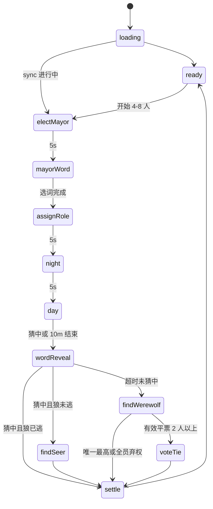

# 狼人真言 - 产品文档（示例）

> gameId: `werewords`  
> 版本: **v2.0**（kit 示例；结构见 `product-doc.template.md`）  
> **不含** IM/REST 字段（见 `im.md` / `rest.md`）

---

## 1. 概述

| 项 | 内容 |
|----|------|
| 游戏名称 | 狼人真言（Werewords） |
| 适用场景 | 语音房 H5 小游戏，4～8 人 |
| 角色 | 随机指定**村长** 1 名（额外身份）；所有玩家随机分配为**狼人** 1 名、**预言家** 1 名、**其余为村民** |
| 玩法概述 | 玩家们通过向村长提问猜出**魔法咒语**，过程中留意每个人的身份，决出狼人阵营与好人阵营的胜负 |

### 整局流程

> 各阶段**主流程**概览；分支、异常与元素细节见后文各阶段章节。`find-seer` 与 `find-werewolf`（及 `vote-tie`）互斥。  
> **视角列随阶段变化**：开局尚不知身份与村长；产生村长后仅知**谁是村长**；**分配身份**后各玩家仅知**自己**的身份，不知他人。

#### A. 开局（尚未产生村长，身份未分配）

| 阶段 | 创建者 | 已加入玩家 | 观众 |
|------|--------|------------|------|
| **准备阶段** | 人数 4～8 时可开始游戏；可取消准备 | 等待开始；可取消准备 | 观战；可加入 |

#### B. 产生村长与选咒（已知村长是谁，身份仍未分配）

| 阶段 | 村长 | 其他已加入玩家 | 观众 |
|------|------|----------------|------|
| **随机村长** | 被公示为本局村长 | 观看公示 | 观看 |
| **村长选咒语** | 从候选中选择或自定义**魔法咒语** | 等待，**不可见**咒语候选 | 观看 |

#### C. 对局（身份已分配；下表按「若你是该身份」描述，**仅见自己身份**）

| 阶段 | 村长 | 预言家 | 狼人 | 村民 | 观众 |
|------|------|--------|------|------|------|
| **分配身份** | 查看**自己的**身份牌 | 同左 | 同左 | 同左 | 等待，无身份牌 |
| **天黑** | 咒语常显 | 查看咒语 | 查看咒语 | 咒语为 `？？？` | 观看 |
| **天亮** | 回答提问（是/不是/不知道）；**不可**提问或猜咒语；咒语常显 | 提问或猜咒语；可切换查看咒语 | 同预言家 | 提问或猜咒语；咒语为 `？？？` | 观战，只读 |
| **咒语公示** | 观看咒语揭晓 | 同左 | 同左 | 同左 | 观看 |
| **找预言家** | 等待 | 等待 | 指认一名玩家是否为预言家 | 等待 | 观看 |
| **找狼人** | 投票指认狼人 | 同左 | 同左 | 同左 | 观看 |
| **平票第二轮** | 若非平票当事人：在候选人中再投一票 | 同左 | 同左 | 同左 | 观看 |
| **结算** | 查看胜负、全员身份公示与统计 | 同左 | 同左 | 同左 | 查看结果；可回首页或加入 |

> **重叠说明**：同一人可同时是创建者、村长与某身份（如村民）。表中「村长 / 预言家 / 狼人 / 村民」列描述**你持有该身份时**的行为；兼任村长时，**天亮**等阶段优先按村长列。

### 前后端职责

| 侧 | 职责 |
|----|------|
| **后端** | 全部游戏逻辑真源：阶段流转、胜负、计票/平票/弃权、猜中判定、逃跑与换村长、倒计时、队列等 |
| **前端** | 按契约展示 UI、采集操作并上报；**不实现、不推断**裁决逻辑；只渲染 IM/sync 下发的状态 |

> ④ 对接时以后端契约为准。冲突记入 `CONTRACT_GAPS.md`，不得前端自行补逻辑。

---

## 2. 全局规则

### 2.1 阶段总表

| 阶段 ID | 显示名称 | 时长 | 可离开？ |
|---------|----------|------|----------|
| `loading` | 加载中 | - | - |
| `ready` | 准备阶段 | - | 是 |
| `elect-mayor` | 随机村长 | 5s | 否 |
| `mayor-word` | 村长选词 | 15s | 否 |
| `assign-role` | 随机身份 | 5s | 否 |
| `night` | 天黑请闭眼 | 5s | 否 |
| `day` | 天亮了 | 10m | 否 |
| `word-reveal` | 词语公示 | 5s | 否 |
| `find-seer` | 找预言家 | 2m | 否 |
| `find-werewolf` | 找狼人（第一轮） | 2m | 否 |
| `vote-tie` | 平票第二轮 | 1m | 否 |
| `settle` | 结算 | - | 是 |

> `find-seer` 与 `find-werewolf`（+`vote-tie`）互斥。猜中与白天超时均经 `word-reveal` 再分流。

### 2.2 状态流转



### 2.3 角色

| 角色 | 说明 |
|------|------|
| 创建者 | 入座最早；可开始游戏；退出后创建者顺移下一位 |
| 普通玩家 | 已加入非创建者；按身份与阶段操作 |
| 观众 | 未加入；观战；结算可回首页/加入 |
| 村长 | 选词；天亮只回答不提交；参与找狼人投票；知晓词语 |
| 预言家 | 1 人；知晓词语；天亮可提问/猜词（兼村长则不可）；投票票权 1 |
| 狼人 | 1 人；知晓词语；未逃时找预言家阶段指认；投票票权 1 |
| 村民 | 不知词语；天亮可提问/猜词（兼村长则不可） |
| 逃跑玩家 | 断线/退出，或村长连续 2 次答问超时；不可操作；仍可被投 |

### 2.4 胜负与解散

| 结果 | 条件 | 胜利文案 | 失败文案 |
|------|------|----------|----------|
| 好人胜（找狼命中） | 指认对象是狼人 | 真言大白！狼人已现形，好人阵营获胜！ | 迷雾散尽，身份曝光，狼人阵营惜败。 |
| 好人胜（找预言家未中） | 狼人指认未中预言家 | 指认落空，预言家安然无恙，好人阵营获胜！ | 错认先知，狼人阵营惜败。 |
| 好人胜（狼逃+猜中） | 猜中且狼已逃 | 狼人已逃，真言仍破，好人阵营获胜！ | 同伴遁走，狼人阵营惜败。 |
| 狼人胜（找预言家命中） | 狼人指认中预言家 | 暗夜得手！预言家已被识破，狼人阵营获胜！ | 先知暴露，好人阵营惜败。 |
| 狼人胜（找狼未中） | 指认非狼人 | 真言未破，狼人隐于人群，狼人阵营获胜！ | 错放狼人，好人阵营惜败。 |
| 狼人胜（第一轮全员弃权） | 第一轮有效票全 0 | 无人落票，狼人借势获胜！ | 全员弃权，错失审判，好人阵营惜败。 |
| 狼人胜（第二轮再平） | 第二轮仍平票 | 票局难定，迷雾护身，狼人阵营获胜！ | 二轮平票，错失良机，好人阵营惜败。 |
| 解散 | 未逃跑玩家 ≤ 3 | 人数不足，本局提前结束。（副：剩余玩家不足 4 人…） | 同左，无胜负阵营 |
| 观众摘要 | 有胜负 | 本局结果：{好人\|狼人}阵营获胜 | - |

### 2.5 全局边界（细则见各阶段）

- 不可投自己 / 不可指认自己
- 局中观众不可入座
- 未逃跑 ≤ 3 人 → 解散
- 前端不处理竞态，以后端先到的消息为准
- `http-config` 暂沿用仓库预设

### 2.6 状态同步策略（④ 参考）

| 触发 | 需要 | 期望 |
|------|------|------|
| 进页 / 房间就绪 | 是 | 进入真实阶段 |
| App 回前台 | 是 | 静默 sync |
| 断网恢复 | 是 | 恢复阶段、问答、投票、逃跑、村长 |
| 倒计时结束无推送 | 是 | 短时后 sync 兜底 |
| 结算回 ready | 是 | sync 入座列表 |

### 2.7 GitLab Markdown 渲染约定 {#27-gitlab-markdown-渲染约定}

> 真源：`h5-game-loop-kit/docs/LESSONS.md` **L-2026-07-15-01**。本示例 Mermaid 已按此编写。

| 场景 | 规则 |
|------|------|
| Mermaid 阶段 ID 含连字符 | 声明 `state "elect-mayor" as electMayor`；转移与 `note` **只用 camelCase 别名** |
| Mermaid 边标签 | 不用 `～`、`≤`、`≥`、全角括号；用 ASCII 与短横线文案 |
| Mermaid `note` | 用 `note right of alias` … `end note`；**勿**在 note 行内写 `\n` |
| 表格空单元格 / 不可见 | 用 `-`，不用破折号 `—` |

---

## 3. 组件规则 {#组件规则}

> 各阶段通过链接引用本节。元素 ID 统一 `el-*`，与 H5 `data-testid` 一致。

### 3.1 全局壳 {#comp-shell}

| 元素 ID | 文案 | 说明 |
|---------|------|------|
| `el-header-title` | 狼人真言 | 顶栏标题 |
| `el-stage-title` | 当前阶段名 | 随阶段变化 |
| `el-countdown` | 剩余 Ns | 有时限阶段显示 |
| `el-toast-error` | （动态） | 校验/错误 toast |

### 3.2 玩家列表 {#comp-player-list}

| 元素 ID | 文案 | 说明 |
|---------|------|------|
| `el-player-list` | - | 容器；列表项多时**可滚动** |
| `el-player-item` | - | 单项；投票/指认阶段为**可点击（选中）** |
| `el-player-avatar` | - | 头像 |
| `el-player-name` | 昵称 | |
| `el-creator-badge` | 创建者 | ready 起，该玩家是创建者 |
| `el-mayor-badge` | 村长 | elect-mayor 起，当前村长 |
| `el-flee-badge` | 逃跑 | 游戏中已逃跑 |
| `el-answer-marks` | ✓ / ✗ / ? | day、settle；已回答提问计数 |

### 3.3 选词输入 {#comp-word-custom}

| 项 | 约定 |
|----|------|
| 组件 | `createInputField`（见 `src/lib/ui.ts`） |
| 交互 | **可输入**（键盘）；字数统计随输入更新 |
| 字符集 | **仅汉字** |
| 长度 | 2～5 |
| 校验 | 字数统计；超输变红；失败 toast |

### 3.4 天亮统一输入 {#comp-day-input}

| 项 | 约定 |
|----|------|
| 组件 | `createInputField` |
| 交互 | **可输入**（键盘） |
| 字符集 | 不限制仅汉字 |
| 长度 | ≤ **20** |
| 用途 | 提问与猜词**同一框**；是否命中/是否入队由**后端**判定 |

### 3.5 词语展示区 {#comp-word-display}

| 视角 | 规则 |
|------|------|
| **当前村长** | 自知晓起**常显**词语；夜→昼不变成 `？？？`；**无** toggle |
| 预言家/狼人（非村长） | `night` 自动显词；`day`～`word-reveal` 前默认 `？？？`，可 [toggle](#comp-word-toggle) |
| 不知词语者 | 始终 `？？？`，直至 `word-reveal` |
| `word-reveal` | 全员公示真词 |
| 新村长接任 | 若原不可见词，接任后立即常显 |

| 元素 ID | 说明 |
|---------|------|
| `el-word-display` | 词语或 `？？？` |
| `el-btn-word-toggle` | 仅预言家/狼人且非村长；见 [3.6](#comp-word-toggle) |

### 3.6 词语 toggle {#comp-word-toggle}

| 元素 ID | 文案 | 说明 |
|---------|------|------|
| `el-btn-word-toggle` | 👁 类图标 | **可点击（切换）** `？？？` ↔ 词语；村长无此按钮 |

### 3.7 问答历史 {#comp-qa-history}

| 元素 ID | 文案 | 说明 |
|---------|------|------|
| `el-qa-history-entry` | 历史提问 | **可点击** 展开面板 |
| `el-qa-history-panel` | - | 展开后**可见**；列表过长**可滚动**；「关闭」**可点击** |

### 3.8 警告与等待 {#comp-alert}

| 元素 ID | 文案 | 说明 |
|---------|------|------|
| `el-timeout-alert` | 超时，系统已自动选择 | 操作者 + 系统代完成 |
| `el-timeout-notice` | {玩家} 超时… | 其他玩家 + 系统代完成 |
| `el-waiting-overlay` | 等待… | 非操作者等待态 |

---

> **阶段详情表（§4 起）**：**元素 ID** 为第一列；**文案** 为第二列；后续列为本阶段适用的**视角**；最后一列为**异常/备注**。全局壳、玩家列表等见 [§3 组件](#组件规则)。  
> **单元格取值**（展示与交互分开标注）：  
> - `-` 不可见  
> - `可见` 只读展示（可加括号说明，如 `可见（常显）`、`可见（？？？）`）  
> - `可点击` 按钮等，点击即触发  
> - `可点击（单选）` 候选词等多选一  
> - `可点击（切换）` 点击切换显示状态（如 👁 toggle）  
> - `可点击（选中）` 列表项点选目标（投票/指认前高亮）  
> - `可输入` 文本框键盘输入  
> - `可滚动` 内容区可上下滑动浏览  
> 同一元素多种交互时用最贴切的一项；前置条件、禁用态、组合流程写在**异常/备注**。

## 4. 阶段：loading {#stage-loading}

### 4.1 说明

| 项 | 内容 |
|----|------|
| 目的 | 首屏 sync 完成前展示加载 |
| 时长 | - |
| 进入 | 打开游戏页 |
| 离开 | 首屏数据就绪 → 真实阶段 |

**组件**：[全局壳](#comp-shell)

### 4.2 视角·元素·异常

| 元素 ID | 文案 | 全员 | 异常/备注 |
|---------|------|------|-----------|
| `el-loading-spinner` | （加载动画） | 可见 | - |
| `el-toast-error` | 加载失败… | 可见 | 加载失败：toast，可重试（④） |

---

## 5. 阶段：ready {#stage-ready}

### 5.1 说明

| 项 | 内容 |
|----|------|
| 目的 | 入座、等待开局 |
| 时长 | 无硬限时 |
| 进入 | 未开局 / 结算回首页 |
| 离开 | 创建者开始且 4～8 人 → `elect-mayor` |

**组件**：[全局壳](#comp-shell)、[玩家列表](#comp-player-list)

### 5.2 视角·元素·异常

| 元素 ID | 文案 | 创建者 | 已加入玩家 | 观众 | 异常/备注 |
|---------|------|--------|------------|------|-----------|
| `el-player-list` 等 | - | 可见 | 可见 | 可见 | 见 [玩家列表](#comp-player-list) |
| `el-btn-start` | 开始游戏 | 可点击 | - | - | 人数 4～8 人 |
| `el-btn-start-disabled-hint` | 需要 4～8 名玩家… | 可见 | - | - | 人数不合法时 |
| `el-btn-cancel-ready` | 取消准备 | 可点击 | 可点击 | - | 创建者离开 → 顺移下一位 |
| `el-btn-join` | 加入游戏 | - | - | 可点击 | 未满 8 人 |

---

## 6. 阶段：elect-mayor {#stage-elect-mayor}

### 6.1 说明

| 项 | 内容 |
|----|------|
| 目的 | 公示本局村长 |
| 时长 | **5s** |
| 进入 | `ready` 开始成功 |
| 离开 | 5s 后 → `mayor-word` |

**组件**：[全局壳](#comp-shell)、[玩家列表](#comp-player-list)

### 6.2 视角·元素·异常

| 元素 ID | 文案 | 村长 | 其他已加入玩家 | 观众 | 异常/备注 |
|---------|------|------|----------------|------|-----------|
| `el-mayor-announce` | 本局村长是 **{昵称}** | 可见 | 可见 | 可见 | - |
| `el-mayor-badge` | 村长 | 可见 | 可见 | 可见 | 列表中标记村长 |
| `el-countdown` | 5s | 可见 | 可见 | 可见 | 未逃跑 ≤ 3 → 解散 |

---

## 7. 阶段：mayor-word {#stage-mayor-word}

### 7.1 说明

| 项 | 内容 |
|----|------|
| 目的 | 村长选定秘密词语；**候选仅村长可见** |
| 时长 | **15s** |
| 进入 | `elect-mayor` 结束 |
| 离开 | 选词完成 → `assign-role` |

**组件**：[全局壳](#comp-shell)、[玩家列表](#comp-player-list)、[选词输入](#comp-word-custom)、[警告与等待](#comp-alert)

### 7.2 视角·元素·异常

| 元素 ID | 文案 | 村长 | 其他已加入玩家 | 观众 | 异常/备注 |
|---------|------|------|----------------|------|-----------|
| `el-word-options` | - | 可见 | - | - | - |
| `el-word-option` | {候选词} | 可点击（单选） | - | - | 未提交前 |
| `el-word-option-custom` | 自定义 | 可点击（单选） | - | - | 选中后配合输入框 |
| `el-word-custom-input` | 2～5 汉字 | 可输入 | - | - | [选词输入](#comp-word-custom) |
| `el-btn-word-confirm` | 确认选词 | 可点击 | - | - | 超时 → 后端代选 |
| `el-waiting-mayor-word` | 等待村长选择词语… | - | 可见 | 可见 | 不可见咒语候选 |
| `el-countdown` | 15s | 可见 | 可见 | 可见 | - |
| `el-timeout-alert` | 超时，系统已自动选择 | 可见 | - | - | 系统代选时 |
| `el-timeout-notice` | 村长选词超时… | - | 可见 | 可见 | 系统代选时 |
| `el-mayor-change-notice` | 原村长逃跑，新村长是 {昵称} | 可见 | 可见 | 可见 | 村长逃跑：换村长、倒计时重置 |

---

## 8. 阶段：assign-role {#stage-assign-role}

### 8.1 说明

| 项 | 内容 |
|----|------|
| 目的 | 展示本人身份 |
| 时长 | **5s** |
| 进入 | `mayor-word` 完成 |
| 离开 | 5s → `night` |

**组件**：[全局壳](#comp-shell)、[玩家列表](#comp-player-list)

### 8.2 视角·元素·异常

| 元素 ID | 文案 | 村长 | 预言家 | 狼人 | 村民 | 观众 | 异常/备注 |
|---------|------|------|--------|------|------|------|-----------|
| `el-role-card` | 你的身份：… | 可见 | 可见 | 可见 | 可见 | - | **仅见自己** |
| `el-role-hidden-hint` | 其他人看不到你的身份 | 可见 | 可见 | 可见 | 可见 | - | - |
| `el-waiting-role` | 等待身份分配… | - | - | - | - | 可见 | - |
| `el-countdown` | 5s | 可见 | 可见 | 可见 | 可见 | 可见 | ≤ 3 人 → 解散 |

---

## 9. 阶段：night {#stage-night}

### 9.1 说明

| 项 | 内容 |
|----|------|
| 目的 | 知晓者看词；不知者看 `？？？` |
| 时长 | **5s** |
| 进入 | `assign-role` 结束 |
| 离开 | 5s → `day`（村长词语**不**重置为 `？？？`） |

**组件**：[全局壳](#comp-shell)、[玩家列表](#comp-player-list)、[词语展示区](#comp-word-display)

### 9.2 视角·元素·异常

| 元素 ID | 文案 | 村长 | 预言家 | 狼人 | 村民 | 观众 | 异常/备注 |
|---------|------|------|--------|------|------|------|-----------|
| `el-night-title` | 天黑请闭眼 | 可见 | 可见 | 可见 | 可见 | 可见 | - |
| `el-word-display` | 咒语 / `？？？` | 可见（咒语） | 可见（咒语） | 可见（咒语） | 可见（？？？） | 可见（？？？） | [词语展示](#comp-word-display) |
| `el-btn-word-toggle` | - | - | - | - | - | - | 本阶段不显示 |
| `el-countdown` | 5s | 可见 | 可见 | 可见 | 可见 | 可见 | ≤ 3 人 → 解散 |

---

## 10. 阶段：day {#stage-day}

### 10.1 说明

| 项 | 内容 |
|----|------|
| 目的 | 非村长统一输入（提问/猜词）；村长限时回答 |
| 时长 | **10m** |
| 进入 | `night` 结束 |
| 离开 | 猜中或 10m 结束 → `word-reveal` |

**组件**：[全局壳](#comp-shell)、[玩家列表](#comp-player-list)、[词语展示区](#comp-word-display)、[词语 toggle](#comp-word-toggle)、[天亮统一输入](#comp-day-input)、[问答历史](#comp-qa-history)

### 10.2 视角·元素·异常

| 元素 ID | 文案 | 村长 | 预言家 | 狼人 | 村民 | 观众 | 异常/备注 |
|---------|------|------|--------|------|------|------|-----------|
| `el-day-title` | 天亮了 | 可见 | 可见 | 可见 | 可见 | 可见 | - |
| `el-countdown` | 10m | 可见 | 可见 | 可见 | 可见 | 可见 | - |
| `el-word-display` | 咒语 / `？？？` | 可见（常显） | 可见（可切换） | 可见（可切换） | 可见（？？？） | 可见（？？？） | [词语展示](#comp-word-display) |
| `el-btn-word-toggle` | 👁 | - | 可点击（切换） | 可点击（切换） | - | - | 非村长 |
| `el-current-question` | {提问者}：{内容} | 可见 | 可见 | 可见 | 可见 | 可见 | 有待答时 |
| `el-answer-countdown` | 本题剩余 15s | 可见 | 可见 | 可见 | 可见 | 可见 | 有待答时 |
| `el-answer-panel` | - | 可见 | - | - | - | - | 有待答时 |
| `el-btn-answer-yes/no/unknown` | 是 / 不是 / 不知道 | 可点击 | - | - | - | - | 连超 2 次 → 换村长 |
| `el-day-input` | 提问或猜咒语（≤20） | - | 可输入 | 可输入 | 可输入 | - | 非村长且未逃跑；[天亮输入](#comp-day-input) |
| `el-btn-day-submit` | 提交 | - | 可点击 | 可点击 | 可点击 | - | 需先输入；后端判定猜中/入队 |
| `el-guess-hit-notice` | {玩家} 猜中了咒语… | 可见 | 可见 | 可见 | 可见 | 可见 | 猜中时 |
| `el-answer-timeout-notice` | 村长超时未回答本题 | 可见 | 可见 | 可见 | 可见 | 可见 | 不进历史 |
| `el-qa-history-entry` | 历史提问 | 可点击 | 可点击 | 可点击 | 可点击 | 可点击 | 展开面板；仅已回答 |
| `el-qa-history-panel` | 已回答列表 | 可见 | 可见 | 可见 | 可见 | 可见 | 展开后；可滚动；关闭可点击 |
| `el-mayor-change-notice` | 原村长逃跑… | 可见 | 可见 | 可见 | 可见 | 可见 | 保留未答队列 |
| - | - | - | - | - | - | - | 逃跑玩家只读；≤3 解散；竞态以后端为准 |

---

## 11. 阶段：word-reveal {#stage-word-reveal}

### 11.1 说明

| 项 | 内容 |
|----|------|
| 目的 | 全员公示词语；猜中路径公示猜中者 |
| 时长 | **5s** |
| 进入 | `day` 猜中或超时结束 |
| 离开 | 猜中+狼未逃 → `find-seer`；猜中+狼已逃 → `settle`（好人胜）；超时 → `find-werewolf` |

**组件**：[全局壳](#comp-shell)、[玩家列表](#comp-player-list)

### 11.2 视角·元素·异常

| 元素 ID | 文案 | 村长 | 预言家 | 狼人 | 村民 | 观众 | 异常/备注 |
|---------|------|------|--------|------|------|------|-----------|
| `el-word-reveal-panel` | 本局咒语是 **{词}** | 可见 | 可见 | 可见 | 可见 | 可见 | - |
| `el-guess-hit-notice` | {玩家} 猜中了正确词汇 | 可见 | 可见 | 可见 | 可见 | 可见 | 猜中路径 |
| `el-word-reveal-hint` | 即将找预言家 / … | 可见 | 可见 | 可见 | 可见 | 可见 | 按分流路径 |
| `el-countdown` | 5s | 可见 | 可见 | 可见 | 可见 | 可见 | 狼人逃跑 → 好人胜 |

---

## 12. 阶段：find-seer {#stage-find-seer}

### 12.1 说明

| 项 | 内容 |
|----|------|
| 目的 | 狼人指认预言家（狼未逃且已猜中词时进入） |
| 时长 | **2m** |
| 进入 | `word-reveal` 且猜中且狼未逃 |
| 离开 | 指认完成 → `settle`；狼人逃跑 → 好人胜 `settle` |

**组件**：[全局壳](#comp-shell)、[玩家列表](#comp-player-list)、[词语展示区](#comp-word-display)、[词语 toggle](#comp-word-toggle)、[警告与等待](#comp-alert)

### 12.2 视角·元素·异常

| 元素 ID | 文案 | 村长 | 预言家 | 狼人 | 村民 | 观众 | 异常/备注 |
|---------|------|------|--------|------|------|------|-----------|
| `el-find-seer-title` | 找预言家 | 可见 | 可见 | 可见 | 可见 | 可见 | - |
| `el-find-seer-hint` | 狼人请指认 / 等待… | 可见 | 可见 | 可见 | 可见 | 可见 | 狼人列文案为「请指认」 |
| `el-player-item` | - | 可见 | 可见 | 可点击（选中） | 可见 | 可见 | 狼人选指认目标；不可选自己 |
| `el-btn-accuse-seer` | 指认 | - | - | 可点击 | - | - | 需先选中目标 |
| `el-word-display` + toggle | 见 §3.5 | 可见 | 可见 | 可见 | 可见 | 可见 | toggle：预/狼非村长可点击（切换） |
| `el-timeout-alert` | 超时，系统已自动指认 | - | - | 可见 | - | - | 超时代指认 |
| `el-timeout-notice` | 狼人指认超时… | 可见 | 可见 | - | 可见 | 可见 | 超时代指认 |
| `el-countdown` | 2m | 可见 | 可见 | 可见 | 可见 | 可见 | 狼人逃跑 → 好人胜 |

---

## 13. 阶段：find-werewolf {#stage-find-werewolf}

### 13.1 说明

| 项 | 内容 |
|----|------|
| 目的 | 第一轮投票找狼人 |
| 时长 | **2m** |
| 进入 | `word-reveal` 超时未猜中路径 |
| 离开 | 唯一最高 → `settle`；全员弃权 → 狼人胜 `settle`；有效平票(≥2) → `vote-tie` |

**组件**：[全局壳](#comp-shell)、[玩家列表](#comp-player-list)、[词语展示区](#comp-word-display)、[词语 toggle](#comp-word-toggle)

### 13.2 视角·元素·异常

| 元素 ID | 文案 | 村长 | 预言家 | 狼人 | 村民 | 观众 | 异常/备注 |
|---------|------|------|--------|------|------|------|-----------|
| `el-find-werewolf-title` | 找狼人 | 可见 | 可见 | 可见 | 可见 | 可见 | - |
| `el-find-werewolf-hint` | 请投票指认狼人 | 可见 | 可见 | 可见 | 可见 | - | 未逃跑在座 |
| `el-player-item` | - | 可见 | 可见 | 可见 | 可见 | - | 有票权者：可点击（选中） |
| `el-btn-vote-werewolf` | 投票 | 可点击 | 可点击 | 可点击 | 可点击 | - | 需先选中；不可投自己；不可改票 |
| `el-vote-selected` | 高亮 | 可见 | 可见 | 可见 | 可见 | - | 操作者已选时 |
| `el-vote-abstain-self` | 超时未投票，已弃权 | 可见 | 可见 | 可见 | 可见 | - | 本人弃权 |
| `el-vote-abstain-mark` | 弃权 | 可见 | 可见 | 可见 | 可见 | 可见 | 该玩家弃权时 |
| `el-vote-abstain-all-notice` | 本轮无人投票，狼人阵营获胜 | 可见 | 可见 | 可见 | 可见 | 可见 | 全员弃权 → 狼人胜 |
| `el-countdown` | 2m | 可见 | 可见 | 可见 | 可见 | 可见 | 平票 → `vote-tie` |
| - | - | - | - | - | - | - | 已逃跑无票权；≤3 解散 |

---

## 14. 阶段：vote-tie {#stage-vote-tie}

### 14.1 说明

| 项 | 内容 |
|----|------|
| 目的 | 对第一轮平票候选人（≥2 人）再投 |
| 时长 | **1m** |
| 进入 | `find-werewolf` 第一轮有效平票 |
| 离开 | 唯一最高 → `settle`；再平 → **狼人胜** `settle` |

**组件**：[全局壳](#comp-shell)、[玩家列表](#comp-player-list)、[词语展示区](#comp-word-display)、[词语 toggle](#comp-word-toggle)

### 14.2 视角·元素·异常

| 元素 ID | 文案 | 村长 | 预言家 | 狼人 | 村民 | 观众 | 异常/备注 |
|---------|------|------|--------|------|------|------|-----------|
| `el-vote-tie-title` | 平票第二轮 | 可见 | 可见 | 可见 | 可见 | 可见 | - |
| `el-vote-tie-warn` | 再平则狼人获胜… | 可见 | 可见 | 可见 | 可见 | 可见 | 进入即展示 |
| `el-vote-tie-hint` | 平票玩家不投票… | 可见 | 可见 | 可见 | 可见 | 可见 | - |
| `el-vote-tie-candidates` | 候选人高亮 | 可见 | 可见 | 可见 | 可见 | 可见 | 可含逃跑 |
| `el-player-item` | - | 可见 | 可见 | 可见 | 可见 | - | 非平票当事人：可点击（选中） |
| `el-btn-vote-werewolf` | 投票 | 可点击* | 可点击* | 可点击* | 可点击* | - | *非平票当事人且未逃；需先选中 |
| `el-vote-abstain-self/mark` | 弃权相关 | 可见* | 可见* | 可见* | 可见* | - | 同第一轮规则 |
| `el-countdown` | 1m | 可见 | 可见 | 可见 | 可见 | 可见 | 再平 → 狼人胜 |
| - | 平票当事人 | - | - | - | - | - | 本轮无票权，仅提示 |

---

## 15. 阶段：settle {#stage-settle}

### 15.1 说明

| 项 | 内容 |
|----|------|
| 目的 | 胜负或解散；身份公示；提问统计；出口 |
| 时长 | - |
| 进入 | 各阶段胜负/解散条件满足 |
| 离开 | 回首页 / 再来一局 / 观众加入 → `ready` |

**组件**：[全局壳](#comp-shell)、[玩家列表](#comp-player-list)、[问答历史](#comp-qa-history)

### 15.2 视角·元素·异常

| 元素 ID | 文案 | 村长 | 预言家 | 狼人 | 村民 | 观众 | 异常/备注 |
|---------|------|------|--------|------|------|------|-----------|
| `el-settle-result` | - | 可见 | 可见 | 可见 | 可见 | 可见 | - |
| `el-settle-win-copy` | 见 §2.4 | 可见* | 可见* | 可见* | 可见* | - | *胜利方 |
| `el-settle-lose-copy` | 见 §2.4 | 可见* | 可见* | 可见* | 可见* | - | *失败方 |
| `el-settle-dissolve-copy` | 人数不足… | 可见 | 可见 | 可见 | 可见 | 可见 | 解散时 |
| `el-settle-audience-copy` | 本局结果：… | - | - | - | - | 可见 | 有胜负时 |
| `el-settle-role-list` | 全员身份公示 | 可见 | 可见 | 可见 | 可见 | 可见 | - |
| `el-settle-stats` | 是/不是/不知道 | 可见 | 可见 | 可见 | 可见 | 可见 | - |
| `el-qa-history-entry` | 历史提问 | 可点击 | 可点击 | 可点击 | 可点击 | 可点击 | 展开面板 |
| `el-qa-history-panel` | 已回答列表 | 可见 | 可见 | 可见 | 可见 | 可见 | 展开后；可滚动；关闭可点击 |
| `el-btn-home` | 回到首页 | 可点击 | 可点击 | 可点击 | 可点击 | 可点击 | - |
| `el-btn-play-again` | 再来一局 | 可点击 | 可点击 | 可点击 | 可点击 | - | 本局玩家 |
| `el-btn-settle-join` | 加入游戏 | - | - | - | - | 可点击 | 未满员 |

---

## 16. 待确认项 {#sec-pending}

- [ ] （玩法或文案待定项）

---

## 17. 修订记录

| 版本 | 日期 | 说明 |
|------|------|------|
| v2.0 | 2026-07-16 | kit 示例；新结构定稿（概述 → 全局 → 组件 → 分阶段矩阵表） |

---

## 附录 A：UI 与素材（可选）

| 项 | 说明 |
|----|------|
| 风格 | 语音房 H5；夜间推理氛围 |
| 素材 | `public/games/werewords/assets/` |
| 回答图标 | 是=✓、不是=✗、不知道=? |
| 输入/弹窗 | `createInputField`、`alertDialog` |
| 触控 | ≥ 44×44 pt |

## 附录 B：与下游文档关系

```
product.md  ← ① 产品确认
    ↓
spec.md     ← ④ 前 L2 用例
    ↓
② UI → ③ 契约 → ④ 接入 → ⑤ E2E 全绿
```
