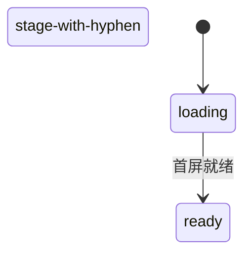

# {{gameName}} - 产品文档

> gameId: `{{gameId}}`  
> 版本: v0.1-draft  
> **不含** IM/REST 字段（见 `im.md` / `rest.md`）

---

## 1. 概述

| 项 | 内容 |
|----|------|
| 游戏名称 | {{gameName}} |
| 适用场景 | 语音房 H5 小游戏，（填写人数范围） |
| 角色 | （填写角色与人数分配） |
| 玩法概述 | （一句话核心玩法） |

### 整局流程

> 各阶段**主流程**概览；分支、异常与元素细节见后文各阶段章节。  
> **视角列随阶段变化**：按玩法划分 A/B/C… 段；每段表头为**本段适用的视角**（如创建者/观众，或身份列）。

#### A. （第一段名称，如开局）

| 阶段 | （视角 1） | （视角 2） | （视角 3） |
|------|------------|------------|------------|
| **（阶段显示名）** | （该视角行为摘要） | | |

#### B. （第二段名称，可选）

| 阶段 | … | … |
|------|---|---|

> **重叠说明**（若一人可兼多角色）：说明多列冲突时的优先级。

### 前后端职责

| 侧 | 职责 |
|----|------|
| **后端** | 全部游戏逻辑真源：阶段流转、胜负、计票、倒计时等 |
| **前端** | 按契约展示 UI、采集操作并上报；**不实现、不推断**裁决逻辑 |

> ④ 对接时以后端契约为准。冲突记入 `CONTRACT_GAPS.md`，不得前端自行补逻辑。

---

## 2. 全局规则

### 2.1 阶段总表

| 阶段 ID | 显示名称 | 时长 | 可离开？ |
|---------|----------|------|----------|
| `loading` | 加载中 | - | - |
| | | | |

> 互斥/分支阶段在此注明（如 A 路径与 B 路径互斥）。

### 2.2 状态流转

> **GitLab 渲染**：见 [§2.7](#27-gitlab-markdown-渲染约定)。阶段 ID 含连字符时必须用 Mermaid 别名。



### 2.3 角色

| 角色 | 说明 |
|------|------|
| | |

### 2.4 胜负与解散

| 结果 | 条件 | 胜利文案 | 失败文案 |
|------|------|----------|----------|
| | | | |

### 2.5 全局边界（细则见各阶段）

- （列举全局不变式，如不可投自己、人数下限解散等）

### 2.6 状态同步策略（④ 参考）

| 触发 | 需要 | 期望 |
|------|------|------|
| 进页 / 房间就绪 | 是 / 否 | |
| App 回前台 | 是 / 否 | |
| 断网恢复 | 是 / 否 | |
| 倒计时结束无推送 | 是 / 否 | 无倒计时填「否」 |

### 2.7 GitLab Markdown 渲染约定 {#27-gitlab-markdown-渲染约定}

> 真源：`h5-game-loop-kit/docs/LESSONS.md` **L-2026-07-15-01**。撰写 `product.md` 时在 GitLab 预览须遵守：

| 场景 | 规则 |
|------|------|
| Mermaid 阶段 ID 含连字符 | 声明 `state "elect-mayor" as electMayor`；转移与 `note` **只用 camelCase 别名** |
| Mermaid 边标签 | 不用 `～`、`≤`、`≥`、全角括号；用 ASCII 与短横线文案 |
| Mermaid `note` | 用 `note right of alias` … `end note`；**勿**在 note 行内写 `\n` |
| 表格空单元格 / 不可见 | 用 `-`，不用破折号 `—` |

---

## 3. 组件规则 {#组件规则}

> 各阶段通过链接引用本节。元素 ID 统一 `el-*`，与 H5 `data-testid` 一致。

### 3.1 全局壳 {#comp-shell}

| 元素 ID | 文案 | 说明 |
|---------|------|------|
| `el-header-title` | {{gameName}} | 顶栏标题 |
| `el-stage-title` | 当前阶段名 | 随阶段变化 |
| `el-countdown` | 剩余 Ns | 有时限阶段显示 |
| `el-toast-error` | （动态） | 校验/错误 toast |

### 3.2 玩家列表 {#comp-player-list}

| 元素 ID | 文案 | 说明 |
|---------|------|------|
| `el-player-list` | - | 容器；列表项多时**可滚动** |
| `el-player-item` | - | 单项；需点选目标时为**可点击（选中）** |
| `el-player-avatar` | - | 头像 |
| `el-player-name` | 昵称 | |

### 3.3 （其他共用组件，按需增删） {#comp-xxx}

| 元素 ID | 文案 | 说明 |
|---------|------|------|
| | | |

---

> **阶段详情表（§4 起）**：**元素 ID** 为第一列；**文案** 为第二列；后续列为本阶段适用的**视角**；最后一列为**异常/备注**。共用组件见 [§3](#组件规则)。  
> **单元格取值**：  
> - `-` 不可见  
> - `可见` 只读展示（可加括号，如 `可见（常显）`）  
> - `可点击` / `可点击（单选）` / `可点击（切换）` / `可点击（选中）`  
> - `可输入` 文本框键盘输入  
> - `可滚动` 内容区可上下滑动  
> 前置条件、禁用态写在**异常/备注**。

## 4. 阶段：loading {#stage-loading}

### 4.1 说明

| 项 | 内容 |
|----|------|
| 目的 | 首屏 sync 完成前展示加载 |
| 时长 | - |
| 进入 | 打开游戏页 |
| 离开 | 首屏数据就绪 → 真实阶段 |

**组件**：[全局壳](#comp-shell)

### 4.2 视角·元素·异常

| 元素 ID | 文案 | 全员 | 异常/备注 |
|---------|------|------|-----------|
| `el-loading-spinner` | （加载动画） | 可见 | - |

---

## 5. 阶段：ready {#stage-ready}

> **复制 §4 结构**：每个 §2.1 阶段递增编号（§6、§7…）。  
> - **§X.1 说明**：目的 / 时长 / 进入 / 离开 + **组件**链接  
> - **§X.2 视角·元素·异常**：矩阵表；视角列随段变化（如 `loading` 仅「全员」；`ready` 为「创建者 \| 已加入玩家 \| 观众」；身份阶段为各身份列 + 「观众」）

### 5.1 说明

| 项 | 内容 |
|----|------|
| 目的 | |
| 时长 | |
| 进入 | |
| 离开 | |

**组件**：

### 5.2 视角·元素·异常

| 元素 ID | 文案 | （视角 1） | （视角 2） | 异常/备注 |
|---------|------|------------|------------|-----------|
| | | | | |

---

## 16. 待确认项 {#sec-pending}

- [ ] …

---

## 17. 修订记录

| 版本 | 日期 | 说明 |
|------|------|------|
| v0.1-draft | | 初稿 |

---

## 附录 A：UI 与素材（可选）

| 项 | 说明 |
|----|------|
| 风格 | |
| 素材 | `public/games/{{gameId}}/assets/` |
| 触控 | 按钮 ≥ 44×44 pt |

## 附录 B：与下游文档关系

```
product.md  ← ① 产品确认
    ↓
spec.md     ← ④ 前 L2 用例
    ↓
② UI → ③ 契约 → ④ 接入 → ⑤ E2E 全绿
```
