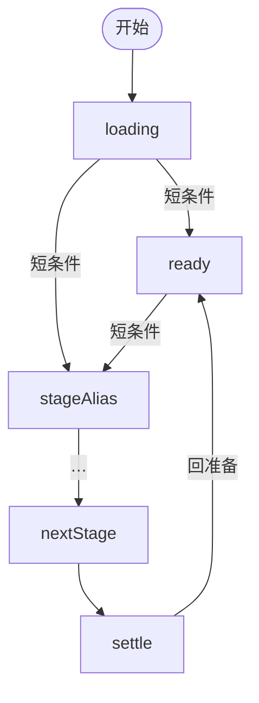

# {{gameName}} - 产品文档

> gameId: `{{gameId}}`  
> 版本: v0.1-draft  
> **不含** IM/REST 字段（见后端仓 `im.md` / `rest.md`；前端指针：`BACKEND-CONTRACTS.md`）

[[_TOC_]]

---

## 1. 概述

| 项 | 内容 |
|----|------|
| 游戏名称 | {{gameName}} |
| 适用场景 | 语音房 H5 小游戏，（填写人数范围） |
| 角色 | （填写角色与人数分配） |
| 玩法概述 | （一句话核心玩法） |

### 整局流程

> 各阶段**主流程**概览；分支、异常与元素细节见后文各阶段章节。  
> **视角列随阶段变化**：按玩法划分 A/B/C… 段；每段表头为**本段适用的视角**（如创建者/观众，或身份列）。

#### A. （第一段名称，如开局）

| 阶段 | （视角 1） | （视角 2） | （视角 3） |
|------|------------|------------|------------|
| **（阶段显示名）** | （该视角行为摘要） | | |

#### B. （第二段名称，可选）

| 阶段 | … | … |
|------|---|---|

> **重叠说明**（若一人可兼多角色）：说明多列冲突时的优先级。

### 前后端职责

| 侧 | 职责 |
|----|------|
| **后端** | 全部游戏逻辑真源：阶段流转、胜负、计票、倒计时等 |
| **前端** | 按契约展示 UI、采集操作并上报；**不实现、不推断**裁决逻辑 |

> **③-F** 对接时以自研后端仓契约为准。冲突或缺字段 → 回 **③-S** 改 `h5-game-server`，不得前端自行补逻辑。

### 1.1 基础设施决策（① 门禁 · 须人工确认）

> **无管理端 / 无 MySQL 的游戏也须填表**（填「否」），确认后方可进 ②。

| 项 | 决策 | 说明 |
|----|------|------|
| 是否需要管理端 | 是 / 否 | 否 → 不做 ③-A、④ 跳过 admin live |
| 是否需要 MySQL | 是 / 否 | 词库/用户资料等；脚本见 `h5-game-server/docs/sql/` |
| 管理功能清单 | （仅「要管理端」时填） | 如：词库 CRUD、审核、配置 |
| Redis / Centrifugo | 默认需要 | 局内态 + IM；一般不改 |

---

## 2. 全局规则

### 2.1 阶段总表

| 阶段 ID | 显示名称 | 时长 | 前端倒计时 |
|---------|----------|------|------------|
| `loading` | 加载中 | - | 否 |
| | | | |

> **前端倒计时**：填「是」的阶段才展示 `el-countdown`；过场类短阶段通常填「否」。倒计时**只做展示**，到点由后端推进（兜底见 §2.6）。  
> **Preview 例外**：侧栏直切阶段时，倒计时为**静态秒数、不递减、不自动跳转**；仅在流程内自动推进的阶段才递减。  
> 互斥/分支阶段在此注明（如 A 路径与 B 路径互斥）。

### 2.2 状态流转

> **GitLab 渲染**：见 [§2.7](#27-gitlab-markdown-渲染约定)。用 **`flowchart TB`**（不用 `stateDiagram-v2`）；图中节点 ID 用 **camelCase**，与 §2.1 连字符阶段 ID 对应；边标签写短条件；**非线性分支**另附下方 **分支说明表**（见 example §2.2）。



**节点 ID**（Mermaid camelCase ↔ §2.1 `阶段 ID`）：`stageAlias` = `stage-with-hyphen` · …

**分支说明**（互斥/例外路径在此列出；线性定时推进可省略）：

| 分支点 | 条件 | 下一阶段 |
|--------|------|----------|
| | | |

### 2.3 角色

| 角色 | 说明 |
|------|------|
| | |

### 2.4 胜负与解散

| 结果 | 条件 | 胜利文案 | 失败文案 |
|------|------|----------|----------|
| | | | |

### 2.5 全局边界（细则见各阶段）

- （列举全局不变式，如不可投自己、人数下限解散等）

### 2.6 状态同步策略（③-F 参考）

| 触发 | 需要 | 期望 |
|------|------|------|
| 进页 / 房间就绪 | 是 / 否 | |
| App 回前台 | 是 / 否 | |
| 断网恢复 | 是 / 否 | |
| 倒计时结束无推送 | 是 / 否 | 无倒计时填「否」 |

### 2.7 GitLab Markdown 渲染约定

> 真源：`h5-game-kit/docs/LESSONS.md` **L-2026-07-15-01**。撰写 `product.md` 时在 GitLab 预览须遵守：

| 场景 | 规则 |
|------|------|
| Mermaid 状态流转（§2.2） | 用 **`flowchart TB`**；节点 ID **camelCase**（如 `electMayor` ↔ `elect-mayor`）；边标签短句；分支条件放 **分支说明表** |
| Mermaid 阶段 ID 含连字符 | 若仍用 `stateDiagram-v2`：声明 `state "elect-mayor" as electMayor`，转移与 `note` **只用 camelCase 别名** |
| Mermaid 边标签 | 不用 `～`、`≤`、`≥`、全角括号；用 ASCII 与短横线文案 |
| Mermaid `note` | 用 `note right of alias` … `end note`；**勿**在 note 行内写 `\n` |
| 表格空单元格 / 不可见 | 用 `-`，不用破折号 `—` |
| **文档内锚点链接** | GitLab 17+ 按 Comrak 算法：小写 → **删除**标点（含 `.`、`：`、`（）` 等，**不**变连字符）→ 空格变 `-` → 重复标题加 `-1`…。例：`### 3.0.2 阶段壳配置（显隐）` → `#302-阶段壳配置显隐`；`## 4. 阶段：loading` → `#4-阶段loading` |
| **锚点自动修复** | 改完本文档执行 **`npm run docs:anchors`**（`scripts/fix-product-md-anchors.mjs`）：按上述算法重写全部内链，并在有悬空锚点时报错退出。提交前可用 `npm run docs:anchors:check` 只校验 |

---

## 3. 组件规则
> 各阶段通过链接引用本节。元素 ID 统一 `el-*`，与 H5 `data-testid` 一致。

### 3.0 壳层与正文（渲染策略）
整局 H5 采用 **「固定壳 + 切换正文」**：外层壳只 mount 一次，阶段切换时**不**整页卸载重建。  
UI 复杂度低（只有两三个阶段、无跨阶段保留的 UI 状态）时本节可整节删除。

#### 3.0.1 固定壳（不随阶段卸载）

下列区域**保持同一组件实例**；阶段切换时仅更新 props / 槽位内容 / 显隐。

| 壳层区域 | 实现 | 阶段切换行为 | 需保留的 UI 状态 |
|----------|------|--------------|------------------|
| 顶栏 | | 始终展示 | |
| 阶段提示条 | | 槽位固定；文案随阶段/视角变 | - |
| 玩家列表 | | 按 `showPlayerList` 显隐；**显隐会卸载** | |
| 全屏蒙层 | | 槽位固定；内部 overlay 条件 mount | 见 [§3.0.4](#304-蒙层-remount) |

#### 3.0.2 阶段壳配置（显隐）

真源：`src/lib/stage-ui-config.ts`。每阶段配置壳层各区域是否展示：

| 字段 | 含义 |
|------|------|
| `showLogo` | Logo 区 |
| `showStageBanner` | 阶段提示条 |
| `showCountdown` | 是否允许展示倒计时（仍需 §2.1 前端倒计时=是 且局内秒数非空） |
| `showPlayerList` | 玩家列表 |
| `layoutMode` | 正文布局模式（见 [§3.2.1](#321-布局模式与切换时机)） |

#### 3.0.3 阶段正文（随阶段 remount）

正文按阶段**互斥切换**：进入新阶段时卸载旧正文、挂载新正文，**不保留**组件内局部 state（滚动位置、未提交输入等），除非写入 **store**。

| 阶段 ID | 正文 SFC | 主要 UI |
|---------|----------|---------|
| | | |

> 需跨阶段保留的数据放 **store**；**不要**为了保留局部 state 把整段正文抬进固定壳。

#### 3.0.4 蒙层 remount
各 overlay 在条件为真时**独立 mount**，关闭或切阶段后**卸载**。再次进入同阶段（如 Preview 跳阶段再跳回）会**重新播放** intro / 动画，不保留蒙层内步骤 state。

---

### 3.1 全局壳

| 项 | 约定 |
|----|------|
| **布局顺序** | （顶栏 → 阶段提示条 → 玩家列表 → 阶段正文；写明各阶段差异） |
| **壳层实现** | 见 [§3.0](#30-壳层与正文渲染策略) |
| **阶段提示** | 文案位置与是否按视角区分 |

| 元素 ID | 文案 | 说明 |
|---------|------|------|
| `el-header-title` | {{gameName}} | 顶栏标题 |
| `el-stage-title` | 当前阶段名 | 随阶段变化 |
| `el-countdown` | 剩余 Ns | §2.1 前端倒计时=是 的阶段 |
| `el-toast-error` | （动态） | 校验/错误 toast |

**滚动条**：可滚动区域使用 kit 通用 class **`kit-scrollbar`**（真源 `public/css/kit-scrollbar.css`，见 kit `TECH-STACK.md` §5.5.1）。

### 3.2 玩家列表

| 项 | 约定 |
|----|------|
| **容器** | `el-player-list` |
| **外观** | （卡片/无卡片、头像边框等） |
| **昵称行** | （座位号、昵称、状态徽章顺序；超长昵称截断规则） |
| **滚动** | 列表项超出可视区时可滚动 |

#### 3.2.1 布局模式与切换时机
玩家列表有多种布局时在此定义；只有一种布局可删除本小节。

| 布局模式 | 容器标识 | 视觉结构 | 适用阶段 |
|----------|----------|----------|----------|
| **grid** | 无 | 全部玩家同等排列于 N 列网格 | |
| **（其他）** | `data-*-layout="true"` | | |

| 切换规则 | 说明 |
|----------|------|
| 何时切换 | |
| 何时复位 | |

**各阶段速查**

| 阶段 | 是否展示 | 布局 | 备注 |
|------|----------|------|------|
| | | | |

| 元素 ID | 文案 | 说明 |
|---------|------|------|
| `el-player-list` | - | 容器；布局见 [§3.2.1](#321-布局模式与切换时机) |
| `el-player-item` | - | 单项；需点选目标时为**可点击（选中）** |
| `el-player-avatar` | - | 头像 |
| `el-player-name` | 昵称 | |

### 3.3 （其他共用组件，按需增删）
| 元素 ID | 文案 | 说明 |
|---------|------|------|
| | | |

---

> **阶段详情表（§4 起）**：**元素 ID** 为第一列；**文案** 为第二列；后续列为本阶段适用的**视角**；最后一列为**异常/备注**。共用组件见 [§3](#3-组件规则)。  
> **通用组件也必须逐阶段列出**：即便 [§3](#3-组件规则) 已定义样式与交互，各阶段表格仍须写明该阶段是否展示（`el-player-list`、`el-stage-title`、`el-countdown` 等），不可只写阶段专属元素——否则 ② 无法判断该阶段壳层显隐。玩家列表须注明本阶段的**布局模式**。  
> **单元格取值**：  
> - `-` 不可见  
> - `可见` 只读展示（可加括号，如 `可见（常显）`）  
> - `可点击` / `可点击（单选）` / `可点击（切换）` / `可点击（选中）`  
> - `可输入` 文本框键盘输入  
> - `可滚动` 内容区可上下滑动  
> 前置条件、禁用态写在**异常/备注**。

## 4. 阶段：loading
### 4.1 说明

| 项 | 内容 |
|----|------|
| 目的 | 首屏 sync 完成前展示加载 |
| 时长 | - |
| 进入 | 打开游戏页 |
| 离开 | 首屏数据就绪 → 真实阶段 |
| **布局** | 顶栏 + 中部居中加载块；无阶段提示条、玩家列表 |

**组件**：[全局壳](#31-全局壳)（**子集**：本节 spinner）

### 4.2 视角·元素·异常

| 元素 ID | 文案 | 全员 | 异常/备注 |
|---------|------|------|-----------|
| `el-loading-spinner` | （加载动画） | 可见 | - |

---

## 5. 阶段：ready
> **复制 §4 结构**：每个 §2.1 阶段递增编号（§6、§7…）。  
> - **§X.1 说明**：必填 目的 / 时长 / 进入 / 离开 + **组件**链接；按需补 **布局**、**后端**（自动化与倒计时归属）、**蒙层**、**Preview**（与正式环境的分叉）  
> - **§X.2 视角·元素·异常**：矩阵表；视角列随段变化（如 `loading` 仅「全员」；`ready` 按准备状态拆列；身份阶段为各身份列 + 「观众」）  
>
> **编号规则**：阶段章节从 §4 起按 §2.1 顺序递增，**不留固定编号**；末尾的「待确认项 / 修订记录 / 附录」在最后一个阶段之后顺延编号，避免出现两个同号章节（GitLab 锚点会冲突）。

### 5.1 说明

| 项 | 内容 |
|----|------|
| 目的 | |
| 时长 | |
| 进入 | |
| 离开 | |
| **布局** | （可选） |
| **后端** | （可选：本阶段哪些流转由后端自动完成） |

**组件**：

### 5.2 视角·元素·异常

| 元素 ID | 文案 | （视角 1） | （视角 2） | 异常/备注 |
|---------|------|------------|------------|-----------|
| | | | | |

---

## N. 运营与管理端

> 与 [§1.1 基础设施决策](#11-基础设施决策--门禁--须人工确认) 一致并展开。无管理端可标「无」。

| 项 | 说明 |
|----|------|
| 是否需要管理端 | 同 §1.1 |
| 管理功能 | 页面与 ops API 清单 |
| 持久化 | MySQL 表与脚本路径 |
| 管理 UI | `h5-game-admin` 路由 |
| 验收 | ③ Mock admin E2E 全绿 + **④ live**（含查库）+ ⑤ sim 可选手动点 admin |

---

## N+1. 待确认项

> 编号接最后一个阶段章节顺延。产品未定、契约待补、Preview 用 mock 顶替的项都记在这里。

| 项 | 说明 |
|----|------|
| | |

---

## N+2. 修订记录

| 版本 | 日期 | 说明 |
|------|------|------|
| v0.1-draft | | 初稿 |

---

## 附录 A：UI 与素材（可选）

| 项 | 说明 |
|----|------|
| 风格 | |
| 素材 | `public/games/{{gameId}}/assets/` |
| 触控 | 按钮 ≥ 44×44 pt |

### A.1 Preview mock 行为（可选）

> Preview 外壳（侧栏 / 多视口 / 视口级 toast）由 kit 提供，规范见 `docs/PREVIEW-UI-SPEC.md`（游戏仓内为只读镜像）。本节只写**本游戏**在 Preview 与正式环境的分叉。

| 项 | 约定 |
|----|------|
| 视角列表 | 与 §1 整局流程各段视角对应；每个视角默认开一个并排视口 |
| 侧栏 Mock 开关 | 按阶段列出（如超时提示、异常分支） |
| 与正式环境分叉 | 侧栏直切阶段时不自动推进；无真实音频 / IM 推送等 |

## 附录 B：与下游文档关系

```
product.md  ← ① 产品确认（含 §1.1 基础设施）
    ↓
spec.md     ← ③-F 前 L2 用例（③ 子门禁 Mock E2E）
    ↓
② Preview → ③ 自主开发（③-S + ③-F + ③-A[按需]）→ ③ 子门禁全绿
    ↓
④ live 真联调全绿（技术交付）→ ⑤ sim 人工（产品终点）
```
